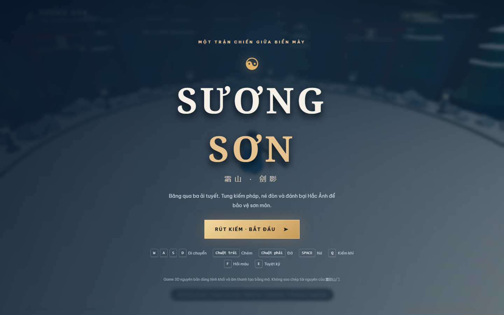
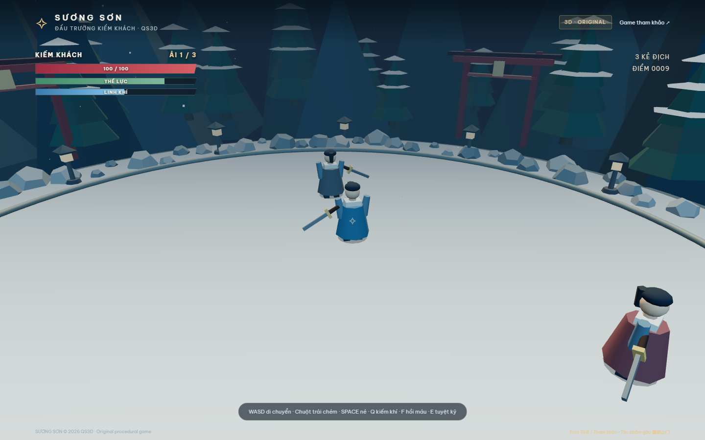
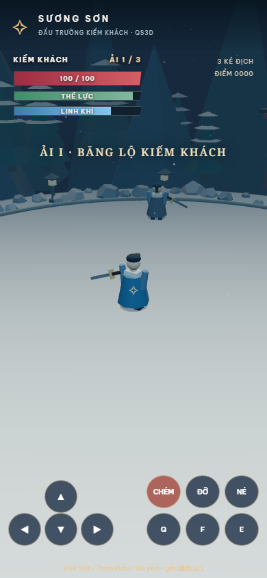
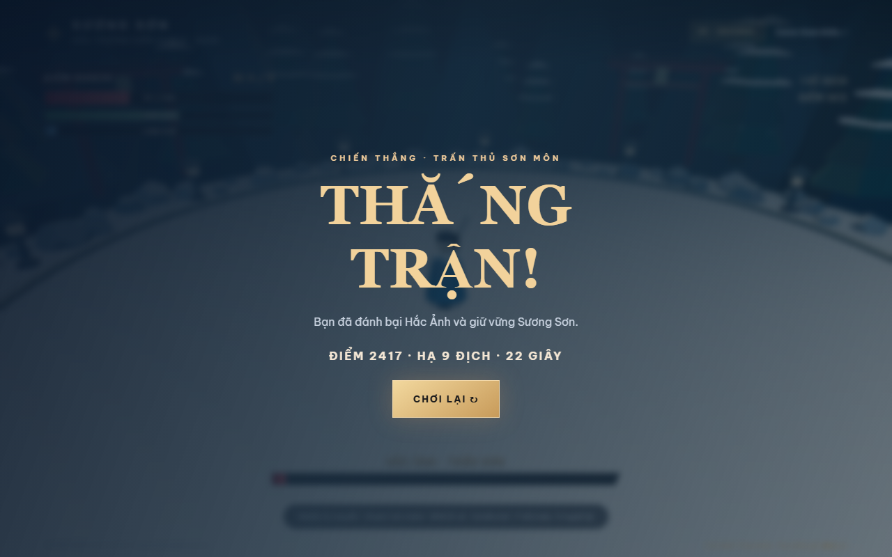

# Sương Sơn · Đấu Trường Kiếm Khách (QS3D)

Original, playable WebGL2 3D action-game demo created for QS3D. **Not a rehost or copy of the copyrighted 雾锁山门 game**.

## Play

- Production: https://guizang.qs3d.site/
- Reference game by Guizang: https://op7418.github.io/guizang-game-skill/
- Full historical fork of the skill and the unpublished demo assets: https://github.com/trinhtanphat/guizang-game-skill

This repository contains independently written mechanics and procedural geometry. It does not import the other game's art, models, music, voice, scripts, or writing.

## Controls

| Control | Action |
| --- | --- |
| W/A/S/D or arrow keys | Walk |
| Left click / J | Sword three-hit combo |
| Hold right click / K | Block |
| Space | Dodge |
| Q | Sword energy |
| F | Heal when injured |
| E | Ultimate |
| Touch buttons | All above actions on mobile |

Fight through 3 waves (3 enemies, 5 enemies, boss), manage health, stamina and mana, then win or retry.

## Run offline / host

Requires Node.js 18+ (no npm install required).

~~~powershell
node server.cjs
~~~

Browse to http://127.0.0.1:5400/. The vendored Three.js module is included, so the graphics work without a CDN; optional external fonts fall back to system fonts.

Run tests with: node --test tests/*.test.cjs

## License and attribution

- All new original game source and procedural artwork in this repository: MIT License, see LICENSE.
- Vendor three.js JavaScript module: MIT License, see THIRD_PARTY_NOTICES.md.
- This project does not grant rights to reproduce the original Guizang game's creative assets.
- The original developer's main skill docs/scripts are AGPL-3.0; upstream gh-pages game creative content is ©2026 Guizang, all rights reserved. They are preserved in a separate Git mirror, not distributed by this site.

## Deploy

On WIN11-181 the standalone staging server runs on port 5400. The dedicated tunnel for guizang.qs3d.site connects to the portal server on port 5398. No unrelated tunnel or production site needs changes.

## QA log

2026-11-13: WebGL2 Chromium Desktop + mobile 13/13 QA PASS. Screenshots and report are in local workspace C:\QS3D-QA\guizang\.

## Screenshots

## Audit evidence and portable browser tests

Read [QA Report 2026-11-13](docs/QA_2026-11-13.md). The production browser QA passed 13/13 smoke checks and completed a full 3-wave boss victory with 9/9 opponents defeated.

The extra automation scripts live in qa/browser-smoke.cjs and qa/full-playthrough.cjs. To rerun them, install playwright-core as a development dependency and connect to a Chrome/Edge instance explicitly started with --remote-debugging-port=9222 in an isolated QA user profile. Optionally set GAME_URL, CDP_URL and QA_OUT_DIR. Browser outputs are stored under qa-out by default (gitignored).

Do not run these scripts against a user's live browser profile or modify unrelated tabs; prefer a dedicated, isolated Chromium QA instance.

## Extended QA and hardening

The 2026-11-13 hardening release adds a 40-check Chromium regression, mobile 360x640 layout validation, actual enemy guard/heal assertions, resource and cooldown tests, accurate elapsed match time on low-FPS devices, and a complete 3-wave boss victory with replay reset. All of these passed on the separate QA build before promotion.

Evidence: [Full QA report](docs/QA_2026-11-13.md), [40-check regression](docs/evidence/regression-40.json), and [full boss win and replay](docs/evidence/full-playthrough-replay.json).

To repeat tests in an isolated environment:

1. Install Node.js 18+ and dependencies with npm install.
2. Run npm test for HTTP/security tests.
3. Start the game with npm start, pointing to an alternate QA port when production runs separately.
4. Start a disposable Chromium profile with remote debugging on a local-only port.
5. Set GAME_URL to the target URL, CDP_URL to that local debugging endpoint, and optionally QA_OUT_DIR to the evidence folder. Run npm run test:browser, npm run test:regression, and npm run test:full.

Playwright creates and closes its own isolated browser contexts. Do not point CDP_URL at a shared interactive session unless you have permission and have protected existing tabs.
