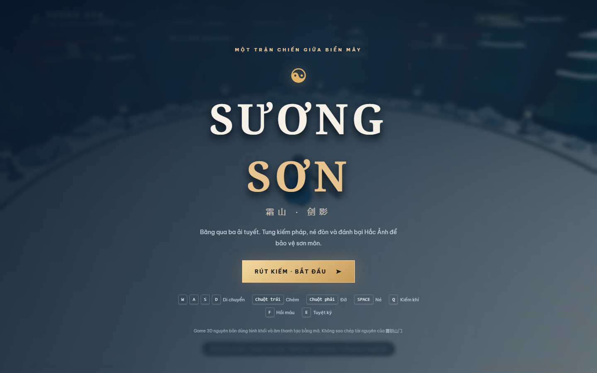
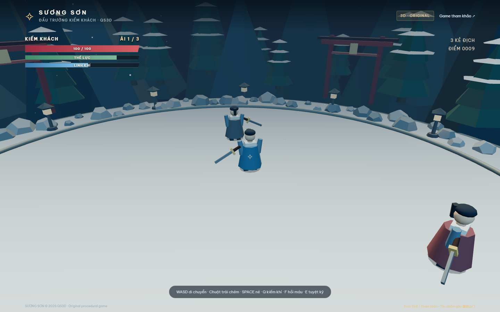
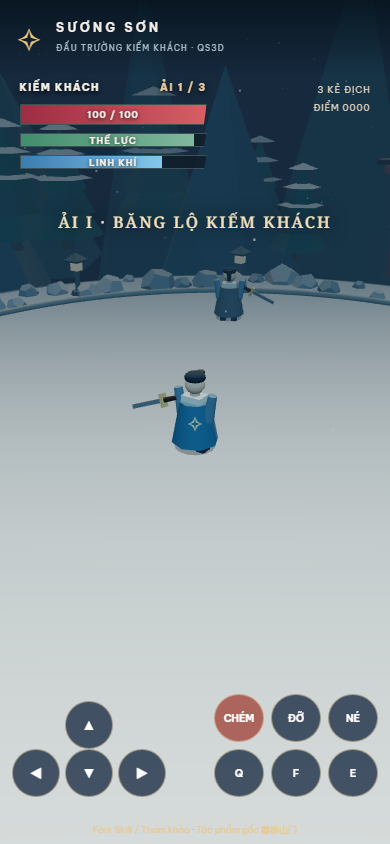
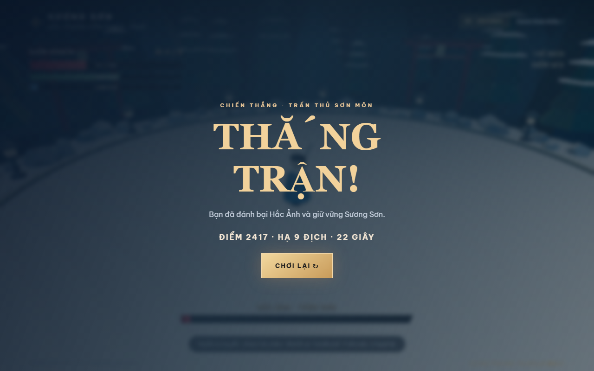

# QA Report · Sương Sơn (QS3D)

**Date:** 2026-11-13 (Asia/Ho_Chi_Minh)  
**Production:** https://guizang.qs3d.site/  
**Original game source:** https://github.com/trinhtanphat/qs3d-suong-son-game  
**Historical Guizang fork:** https://github.com/trinhtanphat/guizang-game-skill

## Scope

This QA covers an independently implemented WebGL2 game and its deployment on QS3D, not an unauthorized republishing of the original Guizang game's creative assets.

## Repository integrity (upstream vs fork)

| Reference | Upstream SHA | Fork SHA | Result |
| --- | --- | --- | --- |
| main | 6001e56e1eaa60be49e5aa4ef81d08b746a1b4e2 | same | PASS |
| gh-pages | 21683d9e00bd3736efe52f78d8380debbd2af3d3 | same | PASS |
| Git tags | None returned | None returned | PASS |

Local full bare mirror on WIN11-181: C:\QS3D\GuizangPortal\guizang-full-mirror.git  
Git fsck --full --no-reflogs: PASS (382 packed Git objects, one pack, no garbage).

## Automated checks

| Check | Result | Evidence |
| --- | --- | --- |
| JavaScript syntax | PASS | Node.js v24 on WIN11-181 |
| HTTP and security unit tests | **8/8 PASS** | tests/http.test.cjs |
| Chromium desktop/mobile production browser checks | **13/13 PASS** | C:\QS3D-QA\guizang\original-public-qa-report.json |
| WebGL2 renderer | PASS | Browser reports webgl2=true and canvas count 1 |
| Desktop move, sword, dodge, sword energy | PASS | Playwright action + state assertions |
| Mobile touch attack | PASS | 390x844 viewport Playwright touch |
| HTTP/JavaScript console (production) | PASS | errors=[], responses=[] |
| Full game playthrough | **PASS** | C:\QS3D-QA\guizang\full-playthrough-result.json |
| Win condition | PASS | mode=victory, wave=3, kills=9, enemies=0 |
| Production page | HTTP 200 | guizang.qs3d.site |
| JS and Three.js module | HTTP 200 | /game.js and /vendor/three.module.js |
| Unrelated production endpoints | HTTP 200 | nongtrai.qs3d.site and painted-valley.qs3d.site |

Browser QA included a local staging pass before promotion and a public production pass after deployment. The public game playthrough passed all 3 waves, defeated 9/9 enemies including the boss, and ended with score 2417, health 37, no reported page exceptions. The game contains no lifted art/model/audio assets from the upstream demo.

## Screenshots

## Deployment and rollback

Dedicated QS3D portal task: QS3D-GuizangPortal-Server181, listening on 127.0.0.1:5398.  
Dedicated tunnel task: QS3D-GuizangPortal-Tunnel181 (separate from shared QS3D services).

Local server implementation: C:\QS3D\GuizangOriginalDemo\server.cjs  
Rollback snapshot: C:\QS3D\GuizangPortal\server.cjs.redirect-backup-20261113  
The old fallback is a legal redirect to the author's official hosted game.

No GitHub Actions were run. No other production domain was modified. No working Session 2 tab was closed.

## Known verification boundaries

- This audit establishes pass/fail for the documented tests, not mathematical proof of 100% code/path coverage.
- No exhaustive real-device GPU compatibility or performance/load testing was performed.
- Original Guizang game art/voice/music/writing remain copyright-protected; this new demo is not that original game.
